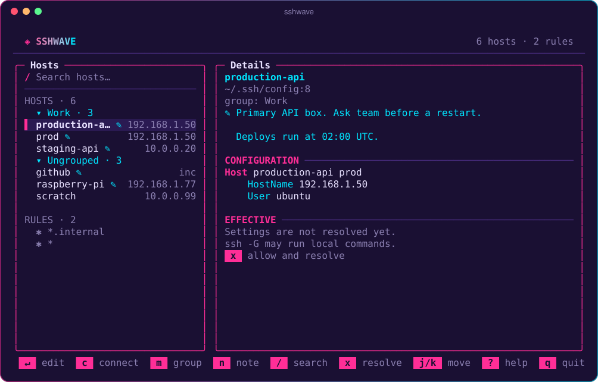

<p align="center"></p>

<p align="center"><b>Browse your <code>~/.ssh/config</code> in a synthwave terminal UI, and edit it without fear.</b></p>

<p align="center">
  <a href="https://github.com/dansku/sshwave/actions/workflows/ci.yml"></a>
  <a href="https://github.com/dansku/sshwave/releases/latest"></a>
  <a href="LICENSE"></a>
</p>

<p align="center"></p>

<p align="center"></p>

## What it does

- Lists the hosts in your config and its `Include` files. Wildcard and `Match` blocks show as rules.
- Fuzzy search over aliases, host names, users, Groups, and Notes.
- Shows each host block as written, and the effective settings from `ssh -G`.
- Groups and multi-line Notes, stored as comments that OpenSSH ignores.
- Opens your config in `$VISUAL` or `$EDITOR` at the selected host, and connects with your own `ssh`.

sshwave is not an SSH client. It keeps no host list of its own and stores no passwords or keys. If you stop using it, your config works as before.

## Install

You need macOS or Linux, and `ssh` in your `PATH`.

```sh
go install github.com/dansku/sshwave/cmd/sshwave@latest
```

Or download `sshwave_<os>_<arch>.tar.gz` and `SHA256SUMS` from the [releases](https://github.com/dansku/sshwave/releases) page (`darwin` and `linux`, `amd64` and `arm64`). Or build from source: `git clone https://github.com/dansku/sshwave && cd sshwave && make build`.

## Use

```sh
sshwave                 # opens ~/.ssh/config
sshwave -config path    # opens another file
```

| Key | Action |
| --- | --- |
| `j` `k` | Move |
| `/` | Search (`Esc` clears) |
| `Enter`, `e` | Back up, then edit in your editor |
| `m` | Move the host to a Group |
| `n` | Edit the Note (`Ctrl+S` saves) |
| `c` | Connect with `ssh` |
| `x`, then `y` | Allow `ssh -G` to show effective settings |
| `?` | All keys |
| `q` | Quit |

To try it without your own config, run `make run CONFIG=testdata/ssh-notes/config` in a clone.

## Groups and Notes

The app stores both as comments directly above the `Host` line:

```
# sshwave: group=Work
# sshwave: note=Primary API box.
# sshwave: note=Deploys run at 02:00 UTC.
Host production-api prod
    HostName 192.168.1.50
    User ubuntu
```

A host block has one Group at most, and a Note of 10 lines at most. A Note is plain text in your config, so do not store a password in it. [docs/tags.md](docs/tags.md) has the exact format.

## Safety

- **Your file stays yours.** The app never reformats your config. A Group or Note change touches only its own comment lines.
- **Backup first.** Before each edit the app saves an exact private copy to `~/.local/share/sshwave/backups/` (the newest 50). If the backup fails, the edit does not start.
- **Consent before `ssh -G`.** `ssh -G` can run `Match exec` commands, so the app asks first, each time the file loads. Note that `c` starts a real `ssh` connection at once.
- **Safe display.** Control characters from files and `ssh` output never reach your terminal.

[docs/safety.md](docs/safety.md) has the full model and how to restore a backup by hand. To report a vulnerability, see [SECURITY.md](SECURITY.md).

## More

Platforms: macOS and Linux. Windows is not supported. To contribute, read [CONTRIBUTING.md](CONTRIBUTING.md) and the [Code of Conduct](CODE_OF_CONDUCT.md). License: [MIT](LICENSE).

Built with [Bubble Tea](https://github.com/charmbracelet/bubbletea), [Lip Gloss](https://github.com/charmbracelet/lipgloss), and other [Charm](https://charm.sh) libraries. The look was inspired by [Crush](https://github.com/charmbracelet/crush); sshwave shares no code with it.
